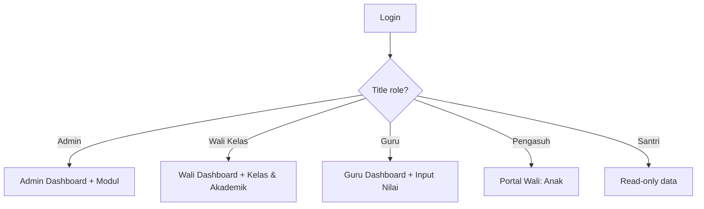

# UI/UX SPECIFICATION — Aplikasi Pondok Banat (MVP)

> **Tujuan:** memudahkan pengguna mengoperasikan aplikasi. Desain sederhana, mobile-first, bahasa Indonesia, fokus pada tempat yang perlu.
>
> **Status:** DPP — Next.js + React + SQLite (dev). Next.js dirancang untuk deploy ke frontend. Prisma + SQLite untuk dev. Skema + seed + tabel SQLite atauquy namunsi. target web: Next.js 15+ + Prisma.
>
> **Recipient:** guru, admin (Wali Kelas/Kurikulum), pengasuh (wali santri), santri, admin 3.

---

## 1. DIIKAH UTAMA DARI 3

1. **Satu hal dulu** — setiap layar menampilkan satu fungsi utama.
2. **Minimal but clear** — elemen yang perlu, tidak ada yang mengganggu.
3. **Mobile-first** — dalam keadaan smartphone, tablet/desktop untuk admin yang lebih detail.
4. **Bahasa Indonesia** — tetap pakai istilah yang dikenal (NIS, jabatan, kelas, etc.), namun tetap jelas.
5. **Consistent navigation** — satu "kembali", satu menu utama yang sama di semua halaman.
6. **Faster** — input lebih cepat dari klik; minimalkan langkah.

---

## 2. PALETTE & COMPONENTS

### 2.1 Palette

| Role | Color | Usage |
|---|---|---|
| Primary | `#1E3A5F` | Biru tua — kedudukan & otoritas utama |
| Accent | `#F59E0B` | Kuning — aksi & peringatan |
| Success | `#10B981` | Hijau — selesai/aktif |
| Danger | `#EF4444` | Merah — masalah/keluar |
| Background | `#F8FAFC` | Latar tubuh |
| Surface | `#FFFFFF` | Kartu/kontainer |
| Text primary | `#1F2937` | Teks utama |
| Text secondary | `#6B7280` | Teks deskriptif |

### 2.2 Core components (web + mobile)

```text
- Card: border-radius: 8px; shadow: ring-1 ring-slate-200 (sederhana, tanpa box-shadow berlebihan)
- Button: padding: 8px 12px; border-radius: 8px; font-weight: 500
- Input: border: 1px solid #E5E7EB; border-radius: 8px; padding: 8px 12px (digunakan sampai number pad)
- Badge: font-size: 11px; padding: 2px 8px; border-radius: 9999px
- Modal: backdrop: rgba(0,0,0,0.4); border-radius: 8px
- Empty state: ilustrasi sederhana + teks pendek + tombol aksi
```

---

## 3. NAVIGATION

### 3.1 Header (mobile & desktop)

```text
┌────────────────────────────────────────────┐
│  Logo  │  Dashboard  │  Rapor │  Setting  │
├────────────────────────────────────────────┤
│                                            │
│  [Katalog modul / menu]                    │
│  ┌────────────────────────────────────┐   │
│  │ Admin & User Mgmt                 │   │
│  │ Master Data Santri                │   │
│  │ ...                              │   │
│  └────────────────────────────────────┘   │
│                                            │
│  [Hasil kerja]  ← konten aktif             │
│                                            │
└────────────────────────────────────────────┘
```

- **Bottom nav** (mobile): 3–5 item utama baru
- **Top header**: logo, nama sekolah, aksi (logout, setting)
- **Menu sidebar** (desktop): lengkap
- **Empty state**: ilustrasi sederhana + teks + tombol aksi

---

## 4. MENU & CARI PINDAI

- **Beranda (Dashboard):** riwayat atau "kegiatan" — data mentah ditekan, penting secara operasional.
- **Data Santri:** data siswa & kelas (M02/M03)
- **Guru & Staf:** jabatan, kartu, jadwal
- **Kurikulum:** silabus, RPP
- **Nilai & Absensi:** nilai, rapor
- **Laporan:** cetak & ekspor
- **Kegiatan:** ruang & kegiatan
- **Wali Santri:** portal wali (M08)
- **Berita:** Bahan & informasi

### Bottom nav (mobile) — 5 item utama

| Icon | Label | Halaman |
|---|---|---|
| 🏫 | Sekolah | /sekolah |
| 👧 | Santri | /santri |
| 📝 | Nilai | /nilai |
| 📊 | Laporan | /laporan |
| 📢 | Berita | /berita |

Sesuaikan dengan role: hanya tampilkan menu yang dapat diakses.

---

## 5. ROLE-BASED HOMPAGE (SINGLE PAGE)

### 5.1 Admin
- **Dashboard:** ringkasan data (total siswa, guru, kelas), menu modul, tombol aksi cepat.
- **View:** tampilan umum lengkap.

### 5.2 Wali Kelas / Kurikulum
- **Dashboard:** ringkasan kelas → nilai, absensi, kegiatan, guru/staf.
- **View:** kelas & akademik, edit nilai, cantumkan data, lihat kegiatan.

### 5.3 Guru
- **Dashboard:** kelas yang diampu, jadwal, presensi, nilai siswa.
- **View:** input nilai, absensi, lihat silabus/RPP, daftar siswa.

### 5.4 Santri (read-only)
- **Dashboard:** nilai/latest activity.
- **View:** nilai tercepat, kegiatan hari ini, pujian/peringatan.

### 5.5 Pengasuh
- **Dashboard:** ringkasan anak → nilai, absensi, aktivitas kegiatan.
- **View:** lihat skor, absensi, notifikasi, kirim pesan ke wali.

---

## 6. SCENARIO SINGKAT

### M02 / M03: Master Data Santri & Guru
```
1. Klik "Santri" dari menu (bottom nav)
2. Tampilan list kelas → klik kelas
3. Tabel siswa (NIS, nama, kelas, status)
4. Filter: kelas, status
5. Tambah siswa: klik "+ Tambah", isi form sederhana
6. Simpan → muncul di tabel
```

### M05: Akademik & Absensi
```
1. Klik "Nilai" dari menu
2. Pilih kelas/siswa
3. Tabel gradebook (mapel, MEI, SMT, ABSEN, HASIL)
4. Input nilai numerik
5. HASIL dihitung otomatis (MEI×0.3 + SMT×0.6 + ABSEN×0.1)
6. Klik "Kirim" → terupdate
```

### M08: Komunikasi & Notifikasi
```
1. Klik "Berita" atau "Wali Santri"
2. Notifikasi akan muncul jika ada
3. Baca pesan, respon
4. Halo portal wali (Baca wali-only)
```

### M09: Laporan
```
1. Klik "Laporan" dari menu
2. Pilih jenis laporan (rapor, harian, keuangan)
3. Pilih kelas/semester/tahun
4. Klik "Preview" → tampil PDF preview
5. Klik "Export PDF" → unduh
```

---

## 7. FORM PATTERNS

### 7.1 Add/Edit form

```text
┌──────────────────────────────┐
│  Form Input Data             │
│                              │
│  Field 1: [input]           │
│  Field 2: [input]           │
│  Field 3: [select]          │
│  Field 4: [textarea]        │
│  Field 5: [input (number)]  │
│                              │
│  [ Batal ]  [ Simpan ]       │
└──────────────────────────────┘
```

- Minimal field: 3–5 field maksimal
- Validation inline (border merah + teks error)
- Auto-save jika memungkinkan
- Bantuan tooltip on hover

### 7.2 Table (data list)

```text
┌───────────────────────────────────────────┐
│  Search: [________]  Filter: [select]     │
├───────────────────────────────────────────┤
│  | NIM | Nama | Kelas | Status | Aksi |  │
│  |-----|------|---------|--------|-----|  │
│  | 2627| Abuya| Takhos  | Aktif  | ↓  │  │
│  | ... | ...  | ...     | ...    | ... │  │
└───────────────────────────────────────────┘
```

- Search bar di atas tabel
- Filter sederhana (dropdown)
- Pagination ketika data banyak (>20)
- Aksi: tombol "Detail", "Edit", "Hapus"

### 7.3 Badge & status

| Status | Badge color |
|---|---|
| Aktif | `#10B981` (green) |
| Non-Aktif | `#9CA3AF` (gray) |
| Wali Kelas | `#F59E0B` (amber) |
| Guru | `#10B981` (green) |
| Santri | `#6366F1` (indigo) |
| Pengasuh | `#3B82F6` (blue) |

---

## 8. FLOW & LAYOUT SUMMARY

### 8.1 Main flow (highest priority: Admin, Guru, Wali Kelas, Pengasuh)



### 8.2 Single-page (one screen at a time)

1. **All screens:** one "kembali" → tombol disebelah kiri.
2. **All screens:** bottom nav (mobile) / header menu (desktop).
3. **All screens:** data berupa card/tabel sederhana.

---

## 9. ACCESSIBILITY & RESPONSIVE

- **Contrast ratio:** ≥ 4.5:1 (teks vs background)
- **Touch target:** ≥ 44×44px (mobile)
- **Screen reader:** friendly (label on all inputs)
- **Language:** Bahasa Indonesia
- **Responsive:** mobile-first, berfungsi juga di tablet/desktop

---

## 10. LAYOUT STRUCTURE (NEXT.JS)

```text
pondok-banat/
├── PRD-PONDOK-BANAT.md          ← module + roadmap
├── src/
│   ├── app/
│   │   ├── layout.tsx           ← root layout
│   │   ├── globals.css          ← theme + base
│   │   ├── page.tsx             ← login
│   │   ├── login/page.tsx
│   │   ├── beranda/page.tsx     ← dashboard (role-aware)
│   │   ├── sekolah/page.tsx
│   │   ├── santri/page.tsx
│   │   ├── guru/page.tsx
│   │   ├── kelas/page.tsx
│   │   ├── nilai/page.tsx
│   │   ├── laporan/page.tsx
│   │   ├── ruang-kegiatan/page.tsx
│   │   ├── pengasuh/page.tsx
│   │   └── berita/page.tsx
│   ├── components/
│   │   ├── ui/                  ← Button, Card, Input, Badge, Table
│   │   └── modules/             ← module-specific UI
│   ├── lib/
│   │   └── db.ts                ← SQLite/Prisma client
│   └── services/
│       └── auth.ts              ← role & permission
└── prisma/
    └── schema.prisma            ← DB schema (SQLite)
```

---

## 11. USER STORY (MVP)

### Admin
- “Saya ingin melihat ringkasan sekolah (jumlah siswa, guru, kelas) di dashboard → cepat dapat info.”
- “Saya ingin mengelola user/role/permission dalam satu tempat → sistem manajemen user.”
- “Saya ingin import data siswa dari Excel → mudah migrasi data.”

### Wali Kelas
- “Saya ingin melihat nilai & absensi kelas → monitoring aktual.”
- “Saya ingin mengirim notifikasi ke pengasuh → komunikasi.”
- “Saya ingin melihat progress nilai siswa → data aktual.”

### Guru
- “Saya ingin input nilai & absensi siswa → asesmen harian.”
- “Saya ingin melihat silabus & RPP → persiapan pembelajaran.”
- “Saya ingin melihat progress kitab siswa → monitoring progres.”

### Pengasuh
- “Saya ingin melihat nilai & absensi anak → monitoring akademik.”
- “Saya ingin melihat aktivitas kegiatan → involvement.”
- “Saya ingin mengirim pesan ke Wali Kelas → komunikasi anak.”

### Santri (read-only sementara)
- “Saya ingin melihat nilai & aktivitas kegiatan → informasi pribadi.”
- “Saya ingin melihat jadwal → mengetahui kegiatan hari ini.”
- “Saya ingin melihat pujian/pijat → motivasi.”

---

## 12. COMMIT

Dibuat dari data + riset. UI/UX disederhankan & mudah dioperasikan. Fitur selengkap mungkin tetap tersedia, namun tampilan dibuat sederhana, jelas, & mudah digunakan.

---

**Next steps:**
1. Next.js scaffold + app router + layout
2. UI/UX spec pendek (ini)
3. Login page + auth flow
4. Optional: next step — integration & CI/CD
